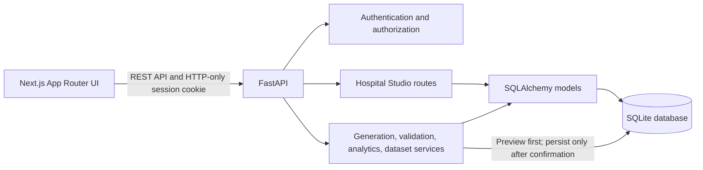

# BedSynth AI

## Project Overview

BedSynth AI is an academic software project for generating, validating, analyzing, and exporting fictional hospital operations datasets. It provides configurable hospital, department, and bed inventories and creates reproducible synthetic records for bed-occupancy and scheduling-model research and testing.

BedSynth AI is an operations-data simulator. It is not an electronic health record (EHR), a clinical decision-support system, or a replacement for hospital administration software. It does not use real hospital patient records. Generated records are fictional and should not be interpreted as clinical or empirically calibrated hospital data.

## Problem Statement

Researchers and students need operational event data to test bed allocation, occupancy, and scheduling algorithms. Real hospital data can contain sensitive information, be subject to sharing restrictions, or be unavailable to people developing and evaluating models. These barriers can make it difficult to share a consistent dataset for repeatable experiments.

BedSynth AI provides configurable, fictional datasets with linked hospital operations records. A fixed random seed and saved generation configuration allow a run to be reproduced without relying on real patient data. Synthetic data is useful for software development and controlled model testing; it does not by itself prove that a model is accurate, safe, or effective in a real hospital.

## Project Objectives

- Configure fictional hospital inventories and publish selected hospitals for registered users.
- Generate reproducible admissions and bed-operations histories within a selected hospital's configured bed scope.
- Validate record relationships, timestamps, assignment intervals, capacity, and occupancy consistency.
- Explore run-level occupancy, patient-flow, department, and comparison analytics.
- Download CSV exports and a versioned JSON manifest for external analysis.
- Enforce administrator permissions and per-user dataset ownership in the backend.

## Key Features

- Administrator management of hospitals, departments, beds, archive state, and hospital publication.
- Read-only hospital selection for normal users, limited to active hospitals published by an administrator.
- Five generation scenarios: Normal Operations, High Patient Inflow, Seasonal Disease Surge, Emergency Surge, and Low Occupancy.
- Configurable patient age and gender distributions, minimum and maximum ages, admission arrival patterns and planned/emergency proportions, department demand weights, and global or department-specific length-of-stay profiles.
- Configurable waiting-queue priority and maximum wait, plus global or department-specific bed-turnaround profiles.
- Deterministic generation from a random seed, with hospital and department scope checks.
- Preview, validation, explicit confirmation, preview-token checking, and idempotency protection before records are persisted.
- User-owned dataset history, details, read-only record previews, CSV downloads, saved validation reports, and soft deletion.
- Hospital analytics for persisted runs, including occupancy, patient flow, department utilization, and same-hospital run comparisons.
- Responsive role-based application navigation and account authentication.

The AI Assistant and guest access have been retired from the active application. Legacy guest tables and historical guest-linked data remain in the database for preservation, but are not exposed through registered-user dataset access.

## User Roles and Permissions

| Role | Main capabilities |
| --- | --- |
| Administrator | Create and manage hospitals, departments, and beds; archive or restore hospital configurations; publish or unpublish hospitals; generate datasets; access their own datasets and analytics. |
| Normal user | Register and sign in; view and select active published hospitals; preview and generate datasets; view, validate, analyze, export, compare, and soft-delete datasets owned by their account. |

New registrations receive the normal `user` role. Users cannot modify hospital configuration. Dataset detail, export, analytics, validation, and deletion APIs enforce ownership for both roles; administrator access does not bypass dataset ownership. Historical runs with no owner remain unassigned and are not returned by registered-user dataset routes.

## System Architecture

The application uses a Next.js frontend and a FastAPI backend. The frontend calls REST endpoints over HTTP and sends the authentication session cookie. FastAPI applies authentication, role, hospital-visibility, and dataset-ownership checks before invoking SQLAlchemy-backed services. The services use SQLite by default for configuration and generated records.



Generation uses the existing Python service and seeded random generation. Preview calculates proposed scope and projected events without saving a completed dataset. Confirmation verifies the preview and request, then writes the run and its operational rows transactionally. Validation reports are stored separately and do not repair or change generated source records.

## Technology Stack

| Area | Technologies used |
| --- | --- |
| Frontend | Next.js App Router, React, TypeScript, Tailwind CSS, Recharts, Lucide, Framer Motion |
| Backend API | Python, FastAPI, Pydantic, SQLAlchemy |
| Database | SQLite by default; SQLAlchemy database URL configuration |
| Generation and analysis | Python standard library, SQLAlchemy-backed generation, validation, analytics, and export services |
| Backend verification | Pytest, HTTPX test client support |
| Frontend verification | Node.js built-in test runner, TypeScript compiler, Next.js production build |

The current generator does not use Gemini, Groq, SDV, Pandas, or NumPy. No AI provider is required to generate datasets.

## Hospital Data Model

The main configuration hierarchy is:

```text
Workspace
└── Hospital
    └── Department
        └── Bed
```

- **Workspace** groups hospital configuration and generation runs.
- **Hospital** belongs to one workspace and has a hospital code, archive state, and an `Available to users` publication flag. An optional network association is supported by the schema.
- **Department** belongs to one hospital and can have a configured bed capacity and archive state.
- **Bed** belongs to one hospital and one department. Its category and status are stored; supported statuses include planned, operational, out of service, and retired.

Every generation run is scoped to one hospital, its workspace, and the selected departments and beds. Operational records include hospital, workspace, and run identifiers to support scoped access and joins.

## Synthetic Data Generation Workflow

1. An authenticated user selects an authorized hospital and departments. Normal users see only active, published hospitals; administrators can configure hospitals and publish them from Hospital Management.
2. The user chooses an inclusive date range, target admission count, target occupancy, scenario, and random seed. Optional settings include patient demographic profiles, planned/emergency mix and arrival patterns, department demand weights, length of stay, waiting behavior, and bed turnaround.
3. The user requests a preview. The backend validates the requested scope and configuration, uses current operational beds, and returns projected generation and validation information without creating the completed dataset.
4. The user reviews the preview and explicitly confirms generation. The backend checks the preview token against the configuration and current hospital inventory, and applies the idempotency key before storing the run.
5. The user opens the completed run in My Datasets. Generated records can be previewed, validated, analyzed, or exported; operational records are not editable through dataset pages.

The generated operational entities are:

- **Synthetic patients:** fictional identifiers and configured age and gender values; no names or contact details are generated.
- **Admissions:** linked to patients, hospital departments, and initial beds. Arrival/request time, planned or emergency type, scheduled time when applicable, and bed-assignment time are distinct fields where available.
- **Discharges:** discharge events linked to admissions. Runs may contain ongoing admissions at the end of the observation window; a missing discharge is not inferred.
- **Bed assignments:** time intervals linking admissions to beds and departments.
- **Transfers:** events linking source and destination departments and beds.
- **Occupancy snapshots:** daily per-department snapshots generated at 12:00 UTC from bed assignment intervals.
- **Waiting-queue entries:** synthetic request outcomes, including waiting, assigned, or maximum-wait-exceeded states.
- **Bed-turnaround records:** configured post-assignment bed turnaround intervals linked to the vacated assignment.

Scenario and generation settings are persisted as run metadata. Identical supported configurations and seeds are intended to reproduce deterministic output. Generation rules are simulator assumptions and are not presented as measurements of actual hospital practice.

## Data Validation and Analytics

The validation service evaluates completed persisted runs and stores a separate report. Implemented checks are grouped into completeness, uniqueness, referential integrity, temporal validity, bed-assignment consistency, capacity consistency, and occupancy accuracy. Checks include run counts, relationships among patients/admissions/beds/assignments/transfers, event ordering, waiting and turnaround intervals, assignment overlaps, capacity bounds, and occupancy calculations. Validation is read-only with respect to the run's generated records.

Analytics are computed from persisted records for a selected run; independent runs are not blended automatically. The analytics page provides occupancy summaries and trends, admission/discharge/transfer flows, department utilization, rule-based observations, and comparisons between compatible runs from the same hospital and department scope. Missing historical metadata or snapshots are shown as unavailable or omitted according to the endpoint, rather than fabricated or silently inferred. These analytics are operational summaries, not clinical assessments, statistical utility evaluations, or privacy-risk measurements.

## Dataset Exports

The Dataset Details page provides run-scoped downloads for the following CSV files when available:

| Export | Content |
| --- | --- |
| `patients.csv` | Synthetic patient identifiers and demographic fields. |
| `admissions.csv` | Admission, patient, hospital, department, bed, type, and arrival-related fields. |
| `discharges.csv` | Discharge events linked to admissions. |
| `bed_assignments.csv` | Bed assignment intervals linked to admissions, beds, and departments. |
| `bed_transfers.csv` | Transfer events and their source/destination beds and departments. |
| `occupancy_snapshots.csv` | Department occupancy counts and rates at snapshot times. |
| `waiting_queue.csv` | Request outcome, priority, assignment, and waiting-duration fields. |
| `bed_turnaround.csv` | Turnaround intervals linked to assignments and beds. |
| `bed_inventory.csv` | Bed and department inventory captured for the generation run, when that historical inventory metadata is available. |

The downloadable JSON manifest documents dataset schema version **1.3.0**, generator version, run configuration and metadata when available, exported files and counts, UTC timestamp convention, relationships, and unavailable historical values. CSV exports preserve run identifiers and relevant foreign keys for external joins. Exports are authorized through the same dataset ownership checks as dataset details.

## Project Folder Structure

```text
.
├── backend/
│   ├── app/
│   │   ├── services/          # Generation, validation, analytics, exports, activity
│   │   ├── auth*.py           # Authentication and account CLI
│   │   ├── models.py          # SQLAlchemy entities and relationships
│   │   ├── routes.py          # Hospital Studio and generation API
│   │   ├── database.py        # Engine, schema initialization, DB session
│   │   └── main.py            # FastAPI application
│   ├── tests/                 # Isolated SQLite backend tests
│   ├── requirements.txt       # Backend runtime dependencies
│   ├── requirements-dev.txt   # Runtime plus test dependencies
│   └── README.md              # Backend routes and operational details
├── frontend/
│   ├── src/app/               # Next.js pages and application styles
│   ├── src/components/        # Shared application shell and landing page
│   ├── src/lib/               # Frontend helpers and Node tests
│   ├── package.json           # Frontend scripts and dependencies
│   └── README.md              # Frontend setup notes
├── docs/
│   └── architecture/         # Hospital domain specification
└── README.md
```

## Installation and Setup

### Prerequisites

- Windows with PowerShell.
- Python 3.13 available through the Python Launcher (`py -3.13`).
- Node.js 18.18 or later and npm.
- Git.

### Backend setup

Run from the repository root in PowerShell:

```powershell
Set-Location .\backend
py -3.13 -m venv .venv313
.\.venv313\Scripts\python.exe -m pip install -r requirements-dev.txt
if (-not (Test-Path .env)) { Copy-Item .env.example .env }
```

The backend loads `backend/.env` using a path relative to its Python package. The example file contains local configuration placeholders and does not need provider keys. The default database URL is `sqlite:///./bedsynth.db`; run backend commands from `backend` so the database file is `backend/bedsynth.db`. Do not overwrite an existing `.env` file.

### Frontend setup

Use a separate PowerShell terminal from the repository root:

```powershell
Set-Location .\frontend
npm install
if (-not (Test-Path .env.local)) { Copy-Item .env.example .env.local }
```

The only variable in the frontend example is `NEXT_PUBLIC_API_BASE_URL`, a browser-visible API URL. Do not put credentials or secrets in frontend environment variables. Do not overwrite an existing `.env.local` file.

## Running the Application

Start the backend from a PowerShell terminal in the repository root:

```powershell
Set-Location .\backend
.\.venv313\Scripts\python.exe -m uvicorn app.main:app --reload --host 127.0.0.1 --port 8000
```

Start the frontend in a second terminal from the repository root:

```powershell
Set-Location .\frontend
npm run dev
```

Open `http://localhost:3000`. The backend health endpoint is `http://127.0.0.1:8000/health`, and interactive API documentation is at `http://127.0.0.1:8000/docs`.

## Demo Hospital Setup

From a PowerShell terminal in the repository root, initialize the schema and seed the fictional sample hospital:

```powershell
Set-Location .\backend
.\.venv313\Scripts\python.exe -m app.demo_seed
```

The command is explicit and repeat-safe. On a fresh database, it creates or reuses `My workspace` and adds four fictional hospital configurations. On an existing database, the three hospitals previously held in `BedSynth Demo Workspace` are moved into `My workspace` only when they have no generation runs in their old workspace and no network association that would become invalid. The old workspace is retained:

| Hospital | Code | Departments and bed capacities | Total |
| --- | --- | --- | ---: |
| **Sunrise General Hospital** | `SGH-001` | Cardiology 25, Emergency 20, General Medicine 30, Neurology 20, Orthopedics 25 | **120** |
| **CityCare Multispecialty Hospital** | `CCH-001` | Emergency 35, Cardiology 30, General Medicine 40, Neurology 20, Orthopedics 25, Pediatrics 25, Obstetrics & Gynecology 25 | **200** |
| **Green Valley Community Hospital** | `GVCH-001` | Emergency 10, General Medicine 25, Pediatrics 15, Maternity 10 | **60** |
| **Apex Specialty Hospital** | `ASH-001` | Cardiology 35, Cardiothoracic Surgery 20, Neurology 15, Orthopedics 15, Oncology 15 | **100** |

The seed command does not create an administrator, user, synthetic patient, generation run, or dataset. It preserves existing hospital, department, and bed settings, adding only missing departments and beds up to each department's current configured capacity. Newly created hospitals default to unpublished; existing publication settings are preserved.

Create the first administrator through the existing interactive CLI; it prompts for credentials and does not provide a default password:

```powershell
Set-Location .\backend
.\.venv313\Scripts\python.exe -m app.auth_cli create-admin
```

Sign in through the application, open **Hospital Management**, and enable **Available to users** for each hospital when it is ready to be used. Registered normal users can then select active published hospitals in the Generator, configure a run, request and review a preview, and explicitly confirm generation.

## Security and Data Privacy

- Only fictional synthetic patient records are generated. Do not enter real patient information.
- Passwords are stored as salted scrypt hashes. Session tokens are opaque, delivered through HTTP-only cookies, and stored in the database as hashes.
- New registrations cannot grant themselves administrator privileges. Backend routes enforce administrator-only configuration changes and published-hospital visibility.
- Dataset detail, export, analytics, validation, comparison, and soft-delete operations are restricted to the signed-in user's own runs, including for administrators.
- Historical runs with null owners and legacy guest-linked records are retained but excluded from registered-user datasets.
- Browser API requests use configured origins and credentialed CORS uses explicit origins. Production deployments should use HTTPS and secure cookie settings.
- Keep `.env`, `.env.local`, SQLite databases, and local generated data out of version control. Never copy secrets into the README or frontend configuration.

This project has not been presented as HIPAA-compliant or as an approved environment for protected health information. Its privacy benefit is that synthetic workflows can be tested without using real hospital records.

## Testing and Verification

Backend tests use isolated temporary SQLite databases. From the repository root:

```powershell
Set-Location .\backend
.\.venv313\Scripts\python.exe -m pytest -v
```

The frontend does not define an `npm test` script or use Vitest/Playwright. Its checked-in tests use Node's built-in runner. Run them, then check TypeScript and create a production build from `frontend`:

```powershell
Set-Location .\frontend
node --test src/lib/role-routing.test.mjs src/app/landing-page.test.mjs src/app/settings/settings-page.test.mjs
npx tsc --noEmit
npm run build
```

The production build can be served locally with `npm run start` after the build completes. Do not point tests at the project database, and do not reset or delete the local database to troubleshoot test failures.

## Limitations and Future Enhancements

BedSynth AI is an academic/MVP simulator. Generation uses explicit simulator rules and configurable distributions; those defaults are not fitted to a particular hospital and are not empirical claims. The application does not implement email verification, password reset, multi-factor authentication, distributed rate limiting, a background job queue, object storage, or automated deployment. Authentication throttling is process-local. The current application does not provide AI-assisted configuration, statistical utility or privacy-risk evaluation, clinical validation, optimization algorithms, or benchmark results.

Possible future work includes validating generation rules against appropriately governed aggregate operational data, adding formal benchmarking datasets and optimization adapters, and evaluating a production database and background processing approach. Such work would require separate design, data governance, and testing; it is not part of the current implementation.

## Conclusion

BedSynth AI provides an end-to-end academic workflow for configuring fictional hospital capacity, generating reproducible synthetic operational events, validating their consistency, reviewing run analytics, and exporting linked datasets. It offers a practical environment for developing and testing bed-occupancy and scheduling software while keeping real hospital records out of the project workflow.
