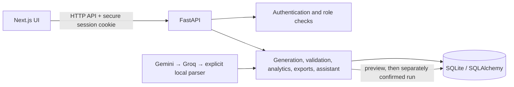

# BedSynth AI

BedSynth AI is a research and academic platform for generating, validating, analyzing, and exporting fictional hospital operations datasets. It helps students and researchers exercise bed occupancy and scheduling workflows without using real patient records.

The project is an operations data simulator, not an electronic health record or hospital management system. Generation is hospital-scoped, reproducible with a seed, and gated by preview, validation, explicit confirmation, and idempotency protection.

## Problem and objectives

Bed-occupancy and scheduling algorithms need event histories and capacity constraints to test their behavior. Real hospital operations data can be sensitive or difficult to share. BedSynth AI supplies reproducible synthetic admissions, stays, bed assignments, transfers, queues, turnaround intervals, and occupancy snapshots using fictional patient profiles.

Project objectives:

- Configure shared hospitals, departments, and beds.
- Generate deterministic, scenario-based operational datasets within configured capacity.
- Validate generated relationships and operational rules before and after generation.
- Explore run-level analytics and compare compatible runs.
- Export persisted records in CSV with a versioned JSON manifest.
- Provide an optional AI assistant for drafting generation configurations; the assistant never creates records.
- Protect workspace access and dataset ownership with authenticated roles.

## Features

- Administrator-managed workspaces, shared hospitals, departments, beds, user accounts, and workspace access.
- Role-specific administrator and research-user dashboards and navigation.
- Scenario presets: Normal Operations, High Patient Inflow, Seasonal Disease Surge, Emergency Surge, and Low Occupancy.
- Configurable patient age and gender shares, admission arrival patterns and types, department demand weights, length-of-stay profiles, waiting behavior, and bed turnaround settings.
- Seeded generation with preview validation, explicit confirmation, and idempotency.
- User-owned dataset history, details, previews, CSV downloads, validation reports, soft deletion, and same-hospital run comparison.
- Hospital-scoped occupancy, patient-flow, department utilization, and deterministic rule-based insights.
- Optional Gemini-primary / Groq-secondary configuration assistant with explicit-value local parsing fallback. The assistant does not accept patient information or trigger generation.

## Roles

| Role | Capabilities |
|---|---|
| Administrator | Manage users and workspace sharing; configure hospitals, departments, and beds; review platform-wide generation runs and summary activity; analyze accessible runs. |
| User | View shared hospitals in read-only mode; generate datasets in authorized shared workspaces; access, validate, compare, export, and soft-delete only datasets they own. |

New registrations receive `user` role. Administrator role changes and workspace sharing are enforced by the API. Historical runs without an owner remain available to administrators and are not assigned to a user.

## Technology

- Frontend: Next.js App Router, React, TypeScript, Tailwind CSS, Recharts, Lucide, Framer Motion.
- Backend: Python, FastAPI, Pydantic, SQLAlchemy, SQLite.
- Generation and analysis: Python standard library and the existing deterministic generation/validation/analytics services.
- Optional assistant providers: Google Gemini and Groq; credentials remain backend-only.
- Tests: Pytest and Node's built-in test runner. The repository does not currently include Vitest or Playwright.

## Architecture



All operational records are linked to a generation run, workspace, and hospital. Analytics use persisted snapshots/events; missing historical metadata is left unavailable rather than inferred. See [the backend guide](backend/README.md) and [hospital domain specification](docs/architecture/HOSPITAL_DOMAIN_SPECIFICATION.md) for detailed semantics and constraints.

## Repository structure

```text
backend/
  app/                 FastAPI routes, auth, SQLAlchemy models, domain services
  tests/               Backend tests using temporary SQLite databases
  requirements.txt     Runtime dependencies
  requirements-dev.txt Test dependencies
frontend/
  src/app/             App Router pages, dashboards, layouts, and styles
  src/components/      Shared application shell and reusable UI
  src/lib/             Small frontend helpers and Node tests
docs/                  Product, architecture, domain, and design documentation
```

## Prerequisites

- Python 3.11 or later supported by the declared dependencies (the maintained Windows environment uses Python 3.13.5).
- Node.js 18.18 or later and npm compatible with Next.js 15.
- Git.

## Local setup

### Backend

From the repository root in PowerShell:

```powershell
cd backend
py -3.13 -m venv .venv313
.\.venv313\Scripts\python.exe -m pip install -r requirements-dev.txt
Copy-Item .env.example .env
```

If `.env` already exists, do not overwrite it. Edit it locally only as needed. The backend loads `backend/.env` using a backend-relative path. The default database URL is `sqlite:///./bedsynth.db`; run Uvicorn from `backend` so it resolves to `backend/bedsynth.db`.

### Frontend

In another terminal from the repository root:

```powershell
cd frontend
npm install
Copy-Item .env.example .env.local
```

If `.env.local` already exists, do not overwrite it. `NEXT_PUBLIC_API_BASE_URL` is a browser-visible URL, not a secret.

## Environment configuration

Backend values are documented in [backend/.env.example](backend/.env.example). Common settings:

| Variable | Purpose |
|---|---|
| `DATABASE_URL` | SQLAlchemy database URL; defaults to a local SQLite file. |
| `FRONTEND_ORIGIN` / `FRONTEND_ORIGINS` | Exact allowed browser origin(s); use comma-separated origins for multiple deployments. |
| `APP_ENV` | Set `production` for production cookie defaults and HTTPS HSTS behavior. |
| `SESSION_COOKIE_SAMESITE` / `SESSION_COOKIE_SECURE` | Cookie policy; hosted cross-site frontend/backend requires `none` and `true` over HTTPS. |
| `GEMINI_API_KEY`, `GROQ_API_KEY` | Optional backend-only assistant keys. Never add them to frontend variables. |
| `GEMINI_MODEL`, `GROQ_MODEL` | Optional provider model identifiers. |

Frontend configuration is in [frontend/.env.example](frontend/.env.example). Never place credentials or secrets in a `NEXT_PUBLIC_*` variable. Example files contain placeholders only.

## First administrator, registration, and login

Create the first administrator interactively from `backend`:

```powershell
.\.venv313\Scripts\python.exe -m app.auth_cli create-admin
```

The CLI prompts for credentials and has no default password. Then run both services and visit `http://localhost:3000/login`. Standard users may register from the login page; registration cannot assign an administrator role. Admin and user dashboards are selected from the server-authenticated session.

## Run the application

Start the API from `backend`:

```powershell
.\.venv313\Scripts\python.exe -m uvicorn app.main:app --reload --host 127.0.0.1 --port 8000
```

Start the frontend from `frontend`:

```powershell
npm run dev
```

Open `http://localhost:3000`. API health is at `http://127.0.0.1:8000/health`; interactive API docs are at `http://127.0.0.1:8000/docs`.

## Workspace and hospital workflow

Administrators create/configure hospitals, departments, and beds in Hospital Management and explicitly share the containing workspace. Users can view active hospitals in shared workspaces but cannot edit hospital configuration. Runs retain their hospital/workspace ownership; cross-hospital comparisons are rejected.

## Dataset generation workflow

1. Select an authorized hospital and departments.
2. Configure the date range, admission count, scenario, seed, age/gender profile, arrival/type mix, length of stay, waiting queue, and turnaround settings as needed.
3. Request a preview. The server validates the current hospital bed scope, configuration, capacity, and expected event relationships.
4. Review validation findings and the previewed configuration.
5. Confirm separately. The server checks the preview token against the configuration and applies the idempotency key before persisting records.
6. Open the completed run in My Datasets or the administrator's All Datasets view.

The AI assistant only proposes configuration values. Its provider response is validated, and an approved configuration must still go through Generator preview and explicit confirmation.

## Exports and analytics

Run details expose available CSVs for patients, admissions, discharges, bed assignments, transfers, occupancy snapshots, waiting queue entries, bed turnaround events, and the generation-scoped bed inventory. A versioned JSON manifest describes schema/generator versions, configuration metadata, counts, UTC timestamps, relationships, and unavailable historical metadata. CSVs are scoped to a run; authorized user access is ownership-checked and administrators can access platform runs.

User analytics include only the user's authorized runs. Comparisons require completed runs from the same hospital with compatible department scope. Administrator dashboard metrics are platform-wide; the Platform Analytics page charts and compares one selected hospital at a time and does not pool hospitals.

## Tests and production build

From `backend`:

```powershell
.\.venv313\Scripts\python.exe -m pytest -v
```

From `frontend`:

```powershell
npm run test:assistant-status
npm run test:role-routing
npm run build
npm run start
```

Backend API tests use isolated temporary databases. Do not point tests at the project SQLite database. Do not delete or reset the local database to troubleshoot; back it up before any deployment schema update.

## Security and privacy

- Passwords use salted scrypt hashes. Session tokens are random, returned only in an HTTP-only cookie, and stored server-side as SHA-256 hashes.
- Sessions expire after 14 days, logout revokes them, and account deactivation removes that user's sessions.
- Login failures are throttled by an in-memory per-account/IP window; registration is throttled by IP. These controls reset on process restart and are not shared across workers. Hosted multi-worker deployments should add trusted edge-level rate limiting.
- Unsafe browser requests are checked against configured origins. Credentialed CORS uses explicit origins; wildcard CORS with credentials is not used.
- API responses are marked no-store and security headers are applied. Production cookies require secure settings; deploy behind HTTPS and configure the exact frontend origin.
- Admin and ownership checks are enforced on backend endpoints, including dataset detail, analytics, comparisons, validation, deletion, and exports.
- Synthetic patient identifiers are generated; do not input real patient data. The assistant's identifier filter is a lightweight guard, not a general PHI detector.
- Keep `.env`, SQLite databases, generated local data, and provider credentials out of Git. Review deployment secrets and backups independently.

## Limitations and future improvements

The application is an academic/MVP local platform. It has no production email verification, password reset, MFA, distributed login throttling, background job queue, object storage, or deployment automation. The admin dashboard has aggregate platform counts, while analytics charts are hospital-scoped. Generated values are simulation rules and defaults, not empirically fitted hospital distributions. Analytics are not statistical utility or privacy-risk evaluations and do not establish that an optimization model is safe or effective. Multi-hospital generation, calibrated operational distributions, model benchmarking, and external optimization integrations require future design and validation.
