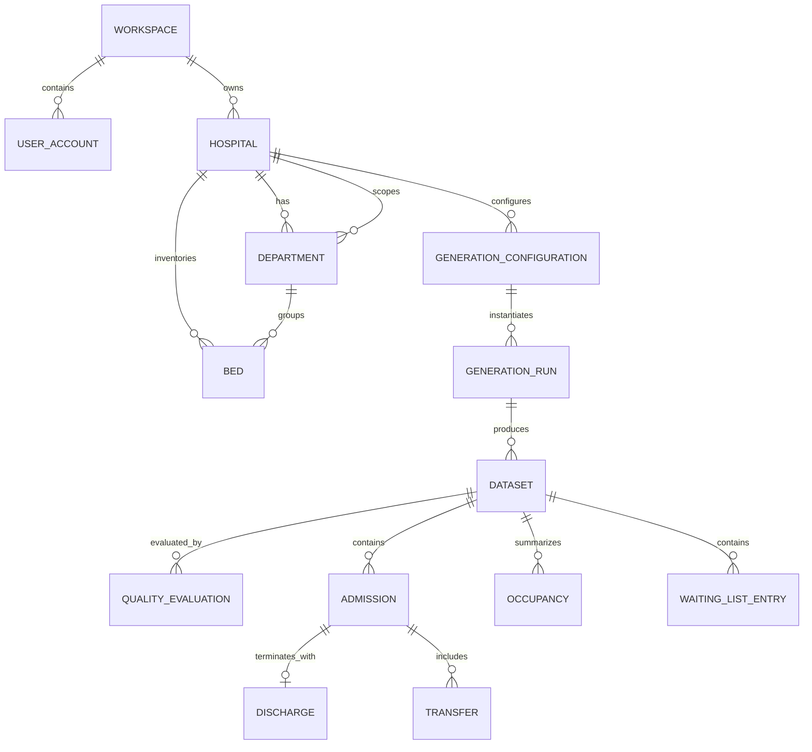

# BedSynth AI Database Schema

**Status:** Logical proposal; physical storage of generated rows and domain semantics require validation. This is not a migration specification.

## Modeling principles

- Separate reusable hospital configuration from immutable per-run snapshots and outputs.
- Use generated internal identifiers, explicit ownership/workspace scope, UTC timestamps, and documented units.
- Preserve source/run provenance on generated records or dataset files.
- Use constraints for stable structural rules; enforce cross-row temporal and capacity rules in domain validation because ordinary foreign keys/check constraints cannot express every invariant.
- Prefer event records as the canonical operational history; derive occupancy snapshots/intervals using a documented definition to avoid conflicting sources of truth.
- The terms below describe proposed logical entities and do not prescribe final column-level physical layout.

## Entities

### User accounts and workspaces

- **UserAccount:** identity subject, normalized email or external identity reference, status, created/updated timestamps. Credential management may be delegated to an identity provider; choice is open.
- **Workspace:** tenant boundary and owner/plan metadata. MVP may use a personal workspace while retaining a workspace foreign key for isolation.
- **WorkspaceMembership (advanced):** workspace, user, role, status, timestamps. Roles and invitation flow require definition before team support.

### Hospitals, departments, and beds

- **Hospital:** workspace, name, optional synthetic location/time zone, status, configuration revision, timestamps.
- **Department:** hospital, stable code/name, optional operational category, active status, timestamps. Department codes are unique within a hospital.
- **Bed:** hospital and department references, stable local bed code, bed type, operational status, effective dates if changes need history. Bed code is unique within a hospital; bed department must belong to the same hospital.
- Hospital operating constraints may be stored as typed configuration records or versioned JSON validated against a schema. Prefer structured columns for queryable core fields; use JSON only for versioned, validated extension settings.

### Admissions, discharges, and transfers

Recommended event-centric approach:

- **Admission:** one synthetic stay/encounter, hospital, optional arrival department/bed, admission timestamp, source/run reference, and synthetic attributes needed for operations. A stay's stable identifier is unique within its dataset/run. Patient identifiers should be synthetic pseudonymous identifiers generated within a dataset, not real identifiers.
- **Discharge:** event linked to one admission, discharge timestamp, optional destination/disposition category. At most one terminal discharge event per stay in the initial model unless readmission/episode semantics are defined differently.
- **Transfer:** event linked to an admission, from/to department and optionally beds, effective timestamp, sequence number. Source/destination may be absent for a defined external transition; this requires explicit semantics.
- Referential integrity ties events to the same hospital and dataset/run. Event time ordering and allowed state transitions are validated by the domain service.

### Occupancy

Two representation options require domain and query validation:

1. **Derived occupancy intervals:** derive bed assignment intervals from admission/transfer/discharge events and bed inventory. This reduces duplicate truth but makes historical calculations dependent on event interpretation.
2. **Materialized occupancy snapshots:** persist timestamped occupancy counts by department/bed category, with derivation version and run reference. This improves charts but must be rebuildable and clearly identified as derived.

For initial planning, model occupancy as a derived dataset output with `as_of` time, hospital/department, occupied count, available count, and derivation metadata. Define whether blocked beds, holds, and partial-day occupancy count before generation implementation. Count must be nonnegative and occupied count must not exceed eligible capacity unless an explicitly permitted exception is recorded.

### Waiting lists

- **WaitingListEntry:** dataset/run, synthetic subject reference or episode reference, requested service/department, request timestamp, priority category if included, status, and optional scheduled/admitted resolution reference.
- Define queue grain, cancellation, duplicate requests, priority meanings, and relation to admissions before implementation. Do not imply clinical triage semantics.

### Generation configurations and dataset metadata

- **GenerationConfiguration:** editable user input associated with hospital and revision; selected tables, time window, requested scale, constraints, method options, and schema version. Capture an immutable snapshot at run submission.
- **GenerationRun:** workspace/hospital, configuration snapshot, requested-by user, status, seed if used, generator and model versions, start/end timestamps, failure summary, and idempotency key where supported.
- **Dataset:** logical output attached to run, schema version, format/storage reference, row counts by table, checksum/manifest reference, creation time, retention state.
- **QualityEvaluation:** dataset/run, evaluator version, check identifier, outcome, measured value, threshold/target if applicable, explanation, evaluated timestamp.
- **Scenario (advanced):** baseline run reference, changed parameters, scenario version/name, and resulting run link.
- **Benchmark (advanced):** benchmark definition/version, model artifact or user-provided result reference, split description, metric definitions/results, and dataset/scenario references. Avoid storing arbitrary executable model code in the application.

## Relationship diagram

The diagram is logical: generated records may be files rather than normalized PostgreSQL tables. User-account/workspace relationship and schema names should be revisited with the identity and tenancy decision.

## Constraints and indexes

- Foreign keys cascade or restrict according to explicit retention/deletion policy; avoid accidental cascading deletion of retained run outputs.
- Unique: workspace-scoped hospital name/code policy as chosen; department code within hospital; bed code within hospital; `(dataset_id, local_record_id)` for generated records where relationally stored; `(admission_id, sequence_number)` for ordered transfers.
- Check: nonnegative requested counts; valid status enums; start/end ordering for time windows; nonnegative occupancy counts; discharge timestamp not before admission timestamp.
- Cross-entity: bed and department must belong to the same hospital; run, dataset, and generated event ownership must agree; transfer chronology and capacity are validated in application logic.
- Index likely access patterns: `(workspace_id, created_at)` for runs; `(hospital_id, status)` for configuration; `(dataset_id, event_time)` and scoped foreign keys for preview queries. Confirm with actual query patterns.
- Use tenant-scoped query filters and authorization checks; database row-level security may be considered after hosting and connection-pooling behavior are validated.

## Open schema decisions

- Whether patient-like synthetic entity identifiers exist at all, and their intended linkage across datasets.
- Event grain and definitions for admissions, observation stays, boarding, discharge, transfer, canceled events, and readmissions.
- Occupancy as-of cadence and treatment of blocked/closed beds, holds, and temporary capacity.
- Whether generated rows live in PostgreSQL, object storage, or both; partitioning/retention requirements.
- Time-zone policy for hospital-local input and UTC event storage.
- Account identity, tenant structure, role model, deletion and retention policy.
- Waiting-list semantics and which fields are operationally safe and meaningful.
