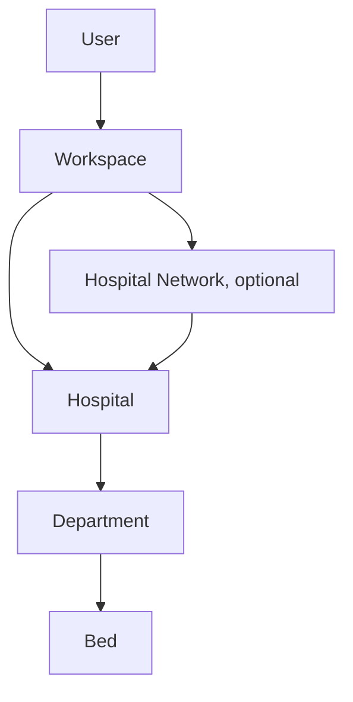
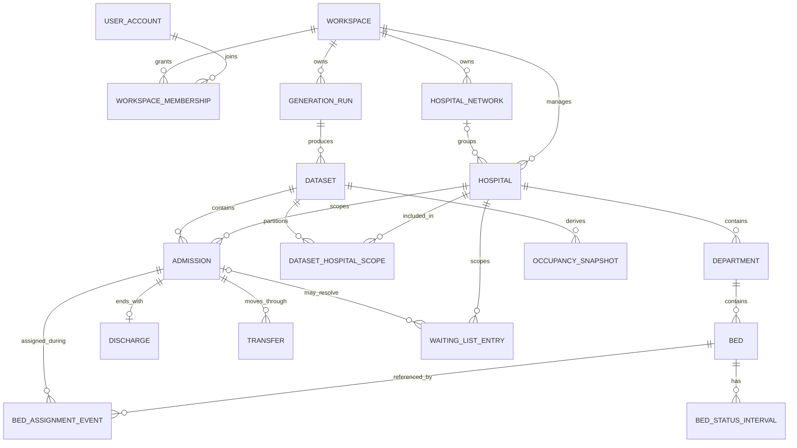

# BedSynth AI Hospital Domain Specification

**Status:** Proposed domain specification incorporating the approved Option C hierarchy.  
**Authority:** The hierarchy and seven ownership/containment rules in “Official architecture” are confirmed requirements supplied by the product owner. Other detailed rules below are proposals for review, not confirmed policy or claims about an implementation.  
**Scope:** Operational synthetic data for development and testing; not a clinical record system.

## 1. Domain overview

BedSynth AI represents users and their workspaces, optional hospital networks, independently manageable hospitals, and operational structures within each hospital. Operational records are always hospital-scoped. Workspace ownership is carried through every configuration, generation run, dataset, and exported record. A hospital may be linked to a network or remain independent.

### Confirmed hierarchy

The `Workspace → Hospital` relationship is direct so a workspace can manage independent hospitals as well as networks. A network groups hospitals; it does not replace hospital ownership or become the owner of operational events. A hospital belongs to at most one workspace. A hospital may have zero or one active network association in the proposed MVP model; multiple simultaneous network membership is an unresolved extension.

### Ownership invariants (confirmed)

1. A workspace can manage multiple hospitals.
2. A hospital can exist independently without belonging to a network.
3. A hospital network can contain multiple hospitals.
4. Each hospital can contain multiple departments.
5. Each department can contain multiple beds.
6. Operational records belong to the correct hospital.
7. Generation preserves hospital and workspace ownership; cross-hospital comparisons cannot incorrectly mix operational records.

## 2. Users, workspaces, and ownership

**Confirmed:** User → Workspace is the top-level ownership path in the approved architecture. A workspace manages its hospital resources.

**Proposed model:** `UserAccount` is an identity; `Workspace` is the tenant/security boundary; `WorkspaceMembership` associates users to workspaces with roles. A personal workspace can support a single-user MVP while retaining the same ownership path. The exact account provider and role matrix are not specified.

All resources should carry `workspace_id` directly or have an unambiguous, integrity-checked path to it. Every request must authorize the user against the workspace before reading or modifying a resource. Do not infer authorization from an opaque identifier. Workspace identity must be checked on hospital, network, configuration, run, dataset, export, and analytics access.

Proposed roles for later validation: `owner` (workspace lifecycle and membership), `admin` (configuration and generation), `member` (use permitted resources), and `viewer` (read-only). MVP may use a single workspace owner if team access is out of scope.

## 3. Hospital network management

`HospitalNetwork` is an optional workspace-owned grouping for hospitals managed or compared together. Proposed attributes:

| Attribute | Purpose |
|---|---|
| `network_id` | Stable internal identifier |
| `workspace_id` | Tenant ownership |
| `name` | User-provided display name |
| `description` | Optional context; no operational meaning by default |
| `status` | Active/archived lifecycle |
| `created_at`, `updated_at` | Audit timestamps |
| `configuration_revision` | Revision for network-level comparison settings, if introduced |

Network membership is represented by a hospital's optional `network_id` or a membership relation if future requirements permit multiple memberships/history. The MVP proposal uses a nullable `hospital.network_id`, requiring the network and hospital to share the same workspace. Removing a hospital from a network must not delete the hospital or its historical data. Archiving a network must not cascade-delete hospitals, runs, or datasets.

The network is an organizational grouping, not a facility. Do not sum or pool network operational data unless an analytics request explicitly selects compatible hospitals, time windows, definitions, and aggregation behavior.

## 4. Independent hospital management and configuration

`Hospital` is the operational boundary for beds, departments, events, capacity, and generated records. It is directly owned by a workspace and optionally associated with a network. Proposed attributes:

- `hospital_id`, `workspace_id`, optional `network_id`.
- Display name and workspace-unique or network-unique local code (uniqueness rule to decide).
- Status: active or archived; archive is not physical deletion.
- Optional synthetic facility location/time zone. Do not require or invent a real address.
- Configuration revision and created/updated timestamps.
- Optional generation defaults, stored as versioned, validated settings.

Each hospital maintains its own departments, beds, capacity rules, local operating calendar, and operational events. Two hospitals can use the same department label or bed code; identifiers are distinct and scoped by hospital. A hospital without a network remains fully configurable and usable for generation.

Configuration changes should be versioned or snapshotted with each run. A run uses one immutable hospital configuration snapshot, even if the live configuration is later edited. Network-level defaults, if eventually added, are templates only: applying a default creates/updates hospital configuration through an explicit action and must not silently override hospital-specific values.

## 5. Departments

`Department` is a hospital-scoped operational unit. Proposed attributes:

- `department_id`, `hospital_id`, local `code`, `name`.
- Optional category/service label from a workspace-defined or controlled vocabulary.
- `status` (active/archived), optional effective interval, timestamps.
- Optional generation constraints reference a versioned configuration.

Rules: department code is unique within a hospital; every bed and department-related operational event references a department in the same hospital; departments from different hospitals are never treated as the same entity merely because their names/codes match. A department cannot be physically deleted while referenced; archive it or use a retention-approved deletion workflow.

## 6. Beds: categories and lifecycle

`Bed` is an inventory slot, not proof that it can accept an admission at every time. Proposed attributes:

- `bed_id`, `hospital_id`, `department_id`, hospital-local `bed_code`.
- `category` or `bed_type` (configurable vocabulary; no fixed clinical taxonomy assumed).
- `status` / effective-dated availability state.
- Optional characteristics needed by an explicitly supported synthetic scenario.
- Configuration revision and timestamps.

Bed categories are labels for grouping and constraint selection. Product owners/domain reviewers must define any category catalog; this specification does not prescribe real-world categories or their counts.

Proposed lifecycle: `planned → operational → out_of_service → operational`, with `retired` terminal. A temporary blocked/held state may be represented separately from out-of-service if the product decides it affects availability. Effective-dated status intervals are preferable when historical capacity must be reconstructed. No overlapping status interval may claim conflicting states for the same bed. Retiring a bed stops future allocation but preserves historical references.

## 7. Admission lifecycle

An `Admission` is a synthetic operational stay/episode in one hospital. Proposed attributes: `admission_id`, `dataset_id`/`run_id`, `workspace_id`, `hospital_id`, synthetic subject token (optional), `admitted_at`, optional initial department/bed, state, and provenance. Dataset-local IDs are recommended so two generated datasets do not accidentally imply the same person.

Proposed state flow: `planned/requested → admitted/open → discharged`; cancellation before admission may be represented as a separate canceled request only if the product includes that scope. An admitted stay has one start instant and no discharge until its terminal discharge event. An admission timestamp cannot precede its generation window except where an explicitly defined warm-start population is supported. Bed assignment can be absent if a supported boarding/unassigned state is defined; do not silently assign an invalid bed.

## 8. Discharge lifecycle

`Discharge` is the terminal closure event for an admission, with `discharge_id`, `admission_id`, `hospital_id`, `discharged_at`, optional non-clinical operational disposition category, and provenance. Proposed baseline: at most one terminal discharge per admission; `discharged_at >= admitted_at`; after discharge, the stay cannot receive later bed occupancy or ordinary inpatient transfers. A readmission is a distinct admission, not a reopening of the discharged admission.

Discharge destination/disposition vocabulary and special cases (transfer to external facility, leave/return, canceled discharge) require domain review. Do not encode clinical reasons unless explicitly approved and needed for the synthetic operational use case.

## 9. Transfers between departments and beds

`Transfer` is an event within one hospital and one admission. Proposed attributes: `transfer_id`, `admission_id`, `hospital_id`, sequence number, `occurred_at`, optional from/to department and bed references, and provenance.

Proposed invariants:

- Admission, transfer, source, and destination all belong to the same hospital and dataset/run.
- Transfer time is within the active stay and not before admission or at/after terminal discharge (boundary ordering must be formalized).
- A `from` location matches the assignment immediately before the event; a `to` location is valid and operational at the event time.
- A destination bed cannot be assigned to two active stays at the same instant.
- If department changes, destination department must match destination bed's department at that event time.
- Same-time events require a deterministic ordering key/sequence. A transfer with no known source/destination is permitted only for an explicitly modeled entry/exit transition.

The model should distinguish movement of the same stay from discharge plus a new admission. Inter-hospital movement is excluded from the MVP proposal; if added, it must be modeled as linked discharge/arrival events across two hospital scopes with explicit provenance, never as one ordinary intra-hospital transfer.

## 10. Bed availability and occupancy definitions

Definitions apply at a selected hospital and instant `t`, under a selected inventory/configuration revision:

- **Total physical beds (`P`)**: all non-retired bed inventory slots belonging to the hospital, including beds currently out of service. If historical inventory is not versioned, historical totals cannot be reconstructed reliably.
- **Out-of-service beds (`O`)**: physical beds not operational at `t` due to their effective-dated status. If temporary holds/blocked beds are modeled, report them separately or explicitly include them in `O`; do not silently change the denominator.
- **Operational beds (`C`)**: `P - O`, the beds eligible to be used under the selected availability policy. If the system later supports additional exclusion states, define whether they reduce `C`.
- **Occupied beds (`Q`)**: operational beds assigned to an active admission at `t`, according to canonical bed-assignment events. An occupied bed count is a count of distinct beds, not the number of transfer/admission events.
- **Available beds (`A`)**: `C - Q`, operational beds not assigned to an active admission. This baseline definition does not include cleaning/turnover holds. If holds are added, distinguish `available_for_assignment` from unassigned operational capacity.
- **Occupancy rate (`R`)**: when `C > 0`, `R = Q / C × 100%`. When `C = 0`, rate is undefined/null (not 0%). Report numerator, denominator, timestamp/cadence, scope, and configuration revision alongside the rate.

Invariants: `0 ≤ O ≤ P`; `0 ≤ Q ≤ C`; `A = C - Q`; therefore `0 ≤ A ≤ C`. Occupancy above capacity is an integrity failure unless a separately specified exception model explicitly permits and labels it. Do not use `Q/P` as the primary rate because it counts out-of-service inventory in the denominator; if a user requests that alternate metric, label it distinctly.

**Limitations:** This is a bed-slot measure, not a measure of staffed capacity, acuity, service suitability, or clinical capacity. It is sensitive to the meaning of operational status, bed holds, time-zone boundaries, event ordering, and snapshot cadence. It does not represent partial occupancy; one bed is either assigned or not at an instant. Any alternative denominator or aggregation must be named and versioned.

## 11. Waiting-list management

`WaitingListEntry` is a synthetic operational request/queue item, not a clinical triage record. Proposed fields: `waiting_list_entry_id`, `workspace_id`, `hospital_id`, dataset/run, requested department/service, request time, optional synthetic subject token, queue status, optional linked admission, and timestamps.

Proposed states: `waiting`, `scheduled` (if scheduling is modeled), `admitted`, `canceled`, `expired`. Every transition is timestamped; admitted entries link to an admission in the same hospital and dataset. Define duplicate request behavior, queue priority semantics, cancellation, eligibility, and whether a request can move between departments before implementing. Avoid clinical urgency labels absent a separately approved definition.

## 12. Hospital capacity constraints

Capacity is derived from a hospital's effective bed inventory and status, optionally filtered by department and category. Proposed constraints for a generation run:

- No more than one active admission assignment per bed at an instant.
- No assignment to an out-of-service or retired bed.
- Department occupancy cannot exceed its eligible operational bed count; hospital occupancy cannot exceed its total eligible operational count.
- Aggregate hospital counts equal the sum across included departments at the same timestamp and under the same inclusion rules.
- Transfers release source assignment and acquire destination assignment atomically at the event boundary, subject to explicit event ordering.
- Configuration revisions used by runs must be immutable snapshots.
- Any exceptional overflow/temporary-capacity behavior is disabled unless explicitly modeled and recorded; default is reject/flag, not silently permit.

No staffing, service compatibility, gender/cohort, isolation, or clinical suitability constraints are implied. These are future domain decisions, and synthetic generation must not present category labels as clinical policy.

## 13. Canonical operational event history and temporal model

The canonical history is an ordered event stream scoped to `(workspace_id, hospital_id, dataset_id)`. Proposed event kinds include `admission_started`, `bed_assigned`, `bed_released`, `transfer_completed`, `discharge_completed`, and `bed_status_changed`. The physical representation may use typed tables (`Admission`, `Transfer`, `Discharge`, bed-status history) rather than a single generic event table; it must still provide one unambiguous sequence for reconstructing state.

Each event has an effective `occurred_at` timestamp in UTC, a stable ID, source entity, hospital/dataset scope, and deterministic tie-break sequence for events with equal timestamps. Store user-entered local time-zone context when needed to explain conversion, but UTC is the comparison basis. Event time and record-created time should be separate if backdated corrections are ever allowed; correction policy is unresolved.

Proposed temporal sequence:

1. Before admission start, the stay consumes no inpatient bed capacity.
2. At admission, the stay becomes active; it may be assigned a bed at the same instant or remain explicitly unassigned under a supported policy.
3. A bed assignment opens a bed-occupancy interval `[assigned_at, released_at)`.
4. A transfer closes the prior assignment interval and opens the destination interval at the transfer instant, with ordered event application preventing double counting.
5. Discharge closes any active bed assignment and ends the active stay at `discharged_at`.
6. At a timestamp exactly equal to a boundary, half-open intervals `[start, end)` mean the old assignment is no longer occupied and the new one is occupied; apply the tie-break order consistently.

### Deriving occupancy snapshots

For each requested snapshot instant `t`, apply all eligible events with effective time `≤ t` in deterministic order, then count distinct operational beds with an active assignment. Join bed status/inventory effective at `t` to compute `P`, `O`, and `C`; calculate `A` and `R` using the definitions above. Persisted snapshots are derived outputs, tagged with derivation version, source dataset/run, configuration revision, time zone/cadence, and calculation parameters. They can be recomputed from the canonical events; snapshots must not silently become a second source of truth.

Snapshot cadence (instantaneous, hourly, daily, or user-selected) is unresolved. Averaging occupancy across snapshots is not equivalent to time-weighted occupancy unless intervals and sampling method are specified.

## 14. Synthetic patient identifiers and privacy boundaries

The initial product focuses on operations rather than clinical records. A synthetic subject token is optional and only needed where linkage across a stay, transfers, or waiting list is part of the scenario. Proposed rules:

- Generate identifiers from a run-scoped namespace, with no source patient identifiers, names, contact data, or other direct identifiers.
- Do not reuse identifiers across datasets by default; cross-run linkage requires explicit requirement and risk review.
- Mark the fields and dataset as synthetic in UI, manifest, and exports.
- Do not treat synthetic values as automatically anonymous or privacy-safe. Learned generators can memorize or disclose training examples; fit-data governance and privacy-risk evaluation are separate requirements.
- Keep operational simulation inputs separate from any real-patient source data. Real data ingestion is outside the stated MVP scope.
- For GenAI, send only the prompt and configuration context needed to produce a structured proposal; do not send generated rows or patient-level content by default. Provider retention, region, and terms require approval.

Privacy-risk evaluation (e.g., membership/disclosure risk or memorization assessment) is distinct from schema checks, statistical utility evaluation, and output validation. Its method, thresholds, and claims are unresolved; do not report “private” based on passing structural checks.

## 15. Multi-hospital dataset generation

Generation scope must be explicit:

- **Single-hospital run (MVP):** one hospital and one immutable configuration revision; all generated operational rows belong to that hospital and its workspace.
- **Multi-hospital run (advanced):** one workspace-scoped run request selecting multiple hospitals, each with a separate hospital-specific sub-configuration and generated partition. A shared run manifest may group outputs, but it does not erase per-hospital ownership or combine local identifiers.
- **Network-selected run:** selection through a network is a convenience for choosing member hospitals. Each hospital remains a separately validated generation scope. A hospital may not be silently included if it belongs to another workspace or is archived/not eligible.

For reproducibility, store a master seed plus a documented per-hospital seed derivation strategy (or explicit per-hospital seeds), configuration revision/hash, schema version, generator and dependency versions, model version where relevant, time window, requested scale, selected tables/constraints, and generation/evaluation code versions. Re-running the same versioned inputs should be deterministic where the method permits; external LLM proposals and some generative methods may not be bit-for-bit reproducible. Preserve the resolved configuration actually used, not just the original prompt.

Generation must validate per hospital before any cross-hospital aggregate is published. A partial multi-hospital run must expose each hospital's status and completeness; never present missing partitions as complete network output.

## 16. Dataset isolation and ownership

Proposed ownership path: `Workspace → GenerationRun → Dataset → Operational rows/partition`. Each run references the selected hospital(s), immutable configuration snapshot(s), and optional network selection snapshot. Each dataset/partition includes `workspace_id`, `hospital_id`, `run_id`, and schema/version metadata. Network membership at generation time should be captured for provenance when network selection matters; current membership changes must not rewrite historical run scope.

Enforce ownership at API authorization and storage query boundaries. Composite foreign keys or equivalent validation should ensure referenced department, bed, admission, dataset, and run all share the same hospital and workspace. If files are used, object keys and manifests must carry tenant/hospital/run scope and access checks must precede signed download links. Avoid cross-tenant global queries and guessed-ID access.

## 17. Cross-hospital analytics

Cross-hospital analytics are advanced. Valid comparisons require explicit hospital selection, common time basis, aligned snapshot cadence, compatible operational definitions, configuration provenance, and documented missing-data handling. Never join operational events across hospitals on a local bed, admission, department, or subject identifier alone.

Proposed approach:

- Aggregate each hospital independently first, then combine approved metrics at the requested reporting grain.
- Normalize comparable metrics with explicit denominators (for example, occupancy rate per hospital) and show both underlying counts and denominator where useful.
- Label network/workspace aggregates with included hospitals, time window, definitions, and partial/failure status.
- Do not pool patient-level rows by default. No cross-hospital synthetic subject identity is implied.
- Do not treat same-named departments or bed categories as semantically equivalent without a mapping reviewed by the user/domain owner.
- Preserve local hospital results alongside a network aggregate so a combined value cannot hide a facility-specific capacity issue.

Whether to calculate pooled rate `sum(Q)/sum(C)` in addition to unweighted mean hospital rate is unresolved. If offered, label formulas separately; they answer different questions.

## 18. Entity descriptions and proposed ER model

The ER diagram shows logical ownership. Generated operational rows may be stored in relational tables, files, or a combination; the physical storage choice remains open.

`DATASET_HOSPITAL_SCOPE` is proposed to represent hospital-specific partitions/status in a multi-hospital dataset. `BED_ASSIGNMENT_EVENT` and `BED_STATUS_INTERVAL` name the logical event concepts; their physical tables may differ. The optional network-to-hospital relation above represents a hospital with zero or one network in the baseline proposal, not an unrestricted many-to-many relationship.

### Proposed key attributes by entity

| Entity | Required scope and core attributes |
|---|---|
| UserAccount | `user_id`, identity reference, account status, timestamps |
| Workspace | `workspace_id`, owner/lifecycle metadata, timestamps |
| WorkspaceMembership | `workspace_id`, `user_id`, role, status, timestamps |
| HospitalNetwork | `network_id`, `workspace_id`, name, status, revision/timestamps |
| Hospital | `hospital_id`, `workspace_id`, nullable `network_id`, name/code, time zone (optional), status/revision |
| Department | `department_id`, `hospital_id`, local code/name/category/status |
| Bed | `bed_id`, `hospital_id`, `department_id`, local code/category/status history |
| GenerationRun | `run_id`, `workspace_id`, requesting user, scope, config snapshot, seed(s), versions, status/timestamps |
| Dataset | `dataset_id`, `run_id`, `workspace_id`, schema, manifest/storage ref, counts, status |
| DatasetHospitalScope | `dataset_id`, `hospital_id`, config snapshot, partition ref/counts/status |
| Admission | `admission_id`, dataset/run, `workspace_id`, `hospital_id`, admitted time, optional subject token |
| Discharge | `discharge_id`, admission, same workspace/hospital/dataset, discharge time |
| Transfer | `transfer_id`, admission, same scope, ordered time, from/to department/bed |
| Bed assignment event | event ID, admission, bed, hospital/dataset scope, event time and sequence |
| Bed status interval | bed, hospital, state, effective start/end, source/config version |
| Occupancy snapshot | dataset/run, hospital/department, as-of time, P/O/C/Q/A/R, derivation metadata |
| WaitingListEntry | entry ID, hospital/dataset scope, request time, service, state, optional resolution link |

## 19. Domain validation rules

Validation should report a stable rule identifier, entity/field context, severity, and a useful correction. Proposed checks:

### Ownership and references

- `HOSPITAL_WORKSPACE_MATCH`: hospital workspace agrees with the selected workspace and optional network workspace.
- `NETWORK_HOSPITAL_SCOPE`: a selected network and every selected hospital share a workspace; independent hospitals are valid when network is null.
- `DEPARTMENT_HOSPITAL_MATCH`: bed and event department references belong to the same hospital.
- `BED_HOSPITAL_MATCH`: assignment references a bed in the admission's hospital.
- `DATASET_RUN_SCOPE_MATCH`: dataset, run, row, and partition ownership values agree.
- `NO_CROSS_HOSPITAL_EVENT_LINK`: transfer, discharge, bed, and admission relationships remain within the hospital, except a future explicit inter-hospital transition type.
- Hospital-local codes are unique within their declared scope.

### Temporal and capacity

- `VALID_TIME_RANGE`: generation window has start before end; event times are within allowed window or explicit warm-start/closing rules.
- `DISCHARGE_AFTER_ADMISSION`: discharge is not earlier than admission.
- `TRANSFER_WITHIN_STAY`: transfer occurs during active admission and obeys deterministic boundary ordering.
- `ASSIGNMENT_INTERVAL_VALID`: assignment start precedes release; no overlapping assignment of one bed to separate active admissions.
- `BED_OPERATIONAL_AT_ASSIGNMENT`: bed is operational at assignment time.
- `DEPARTMENT_MATCHES_BED`: assignment/transfer department agrees with bed department at the event instant.
- `OCCUPANCY_WITHIN_CAPACITY`: `Q ≤ C` for each hospital and time instant.
- `OCCUPANCY_ARITHMETIC`: `A=C-Q`, `C=P-O`, and `R=Q/C` when `C>0`; when `C=0`, R is null.
- `SNAPSHOT_DERIVATION_PROVENANCE`: snapshot formula, cadence, source events, configuration revision, and evaluator version are present.

### Generation quality and reproducibility

- Validate generated tables against versioned schemas and declared foreign keys.
- Validate event sequences and capacity after synthesis; reject, repair under a documented deterministic policy, or mark failed/partial with findings. Never silently drop invalid rows.
- Store effective resolved config, seed strategy, generator/model/dependency versions, schema version, and per-hospital run outcome.
- A retry must not create duplicate completed datasets for the same idempotency key unless a deliberate new run is requested.
- Statistical utility evaluation and privacy-risk evaluation are separate reports from invariant validation, each with method/version and scope.

## 20. Edge cases and failure scenarios

| Scenario | Proposed handling |
|---|---|
| Hospital has no network | Valid independent hospital; network filters must not exclude it from workspace hospital listings unless explicitly requested. |
| Network belongs to another workspace | Reject membership and run selection; do not disclose foreign resource details. |
| Network archived while hospitals remain active | Keep hospitals and history; block new selection through archived network until policy is defined, but allow direct hospital use if still active. |
| Hospital archived with active run | Preserve run/output; reject new runs by default; define cancellation behavior for queued jobs. |
| Department moved between hospitals | Do not mutate hospital ownership in place; create new department and preserve historical references. |
| Bed changes department | Effective-date the move or retire/recreate inventory identity; ensure historical occupancy resolves to the correct department. Policy needs domain approval. |
| Bed goes out of service while occupied | Flag invalid configuration/event combination; require release/transfer before status change, or define emergency exception explicitly. |
| Zero operational beds | Available is zero; occupancy rate is null/undefined, not zero or infinity. |
| Admission without assigned bed | Allow only if an unassigned/boarding state is explicitly in scope; it does not count as occupied bed. |
| Discharge and transfer at same instant | Resolve with event sequence and half-open interval policy; default should reject ambiguous sequence. |
| Duplicate or out-of-order transfer | Reject or mark invalid; do not silently reorder without preserved source ordering and a documented repair. |
| Overlapping stays assigned to same bed | Capacity/integrity failure; generation run cannot be marked complete-clean. |
| Dataset contains several hospitals, one fails | Mark per-hospital and overall partial status; aggregate only with explicit partial inclusion and warning. |
| Config/network membership changes after run | Historical run uses immutable scope/config snapshots; current configuration does not rewrite it. |
| Repeated synthetic identifier across hospitals | Allowed only if independently namespaced and never treated as a cross-hospital person; prefer run-and-hospital-scoped IDs. |
| DST/time-zone transition | Store instants in UTC; retain source zone for user-facing interpretation; ambiguous local input needs explicit offset or resolution policy. |
| Seed reused with different config/version | Not considered same reproducible run; record all inputs and compare provenance, not seed alone. |
| Generation worker crashes mid-run | Persist failed/recoverable status and staged outputs; publish only after validation/commit or clearly expose partial status. |

## 21. MVP versus advanced scope

### MVP proposal

- Workspace ownership and authorization boundary (personal workspace may be the only membership).
- Multiple hospitals per workspace; hospitals optionally associated with one network; independent hospitals supported.
- Hospital → department → bed configuration with basic categories/status and immutable per-run snapshot.
- Single-hospital generation per run, with hospital/workspace identifiers on every operational row and manifest.
- Admission, discharge, intra-hospital transfer/bed assignment events, bed status, derived occupancy snapshots, and basic waiting-list data only if queue semantics are approved.
- Canonical event ordering, occupancy formula above, capacity validation, generation seed/configuration provenance, preview/export isolation.
- Cross-hospital analytics limited to separately calculated, explicitly selected aggregate summaries after definition compatibility checks; no patient-row pooling.

### Advanced proposal

- One run coordinating multiple hospital partitions with per-hospital status and seed derivation.
- Network-level templates, configuration inheritance, multi-user roles, and audit workflows.
- Effective-dated inventory moves and rich bed status/hold states.
- Explicit inter-hospital transfer/continuity model.
- Rich waiting-list scheduling/prioritization semantics.
- Cross-hospital metric mappings, pooled versus average comparisons, scenario simulation, and model benchmarking.
- Privacy-risk evaluation suite and statistical utility evaluation protocol.

## 22. Decisions requiring approval or domain validation

### Confirmed by Option C

- The ownership hierarchy and multiple/optional containment rules stated in Section 1.
- Operational records must be scoped to the correct hospital; generation carries hospital and workspace ownership; cross-hospital data must not be incorrectly mixed.

### Proposed, not yet confirmed

1. A hospital belongs to one workspace and zero or one network; network membership is not many-to-many.
2. Network membership does not itself grant operational ownership or alter hospital-level configuration.
3. MVP generation is single-hospital per run; coordinated multi-hospital runs are advanced.
4. Occupancy formula uses occupied operational beds divided by operational beds, with zero denominator yielding null.
5. Admissions are stays; readmissions use a new admission; one discharge closes a stay.
6. Events use UTC instants, half-open occupancy intervals, deterministic same-time sequence.
7. Waiting lists and patient-like identifiers are optional and minimally modeled; no clinical priority meanings.
8. Specific bed categories, operational status vocabulary, cleaning/hold treatment, warm-start population, and overflow behavior.
9. Cross-hospital comparison formulas, department/category mappings, partial-run aggregation behavior.
10. Physical storage, generation retry/repair behavior, retention, and deletion policies.
11. Privacy-risk evaluation methods and acceptance thresholds; statistical utility targets and any permitted fit-data source.

## 23. Required updates to existing documentation (not applied)

Option C supersedes assumptions that the product configures only one hospital or models a hospital directly under a user. These documents should be updated after review:

- **`docs/product/PRD.md`** — revise vision/objectives, hospital configuration requirements and journeys for workspace → optional network → multiple independent/member hospitals; define single-hospital MVP generation and future coordinated runs; add hospital ownership and cross-hospital analytics acceptance criteria.
- **`docs/architecture/SYSTEM_ARCHITECTURE.md`** — update system boundaries, API resources, data flow and authorization to include workspace/network/hospital scope; describe per-hospital partitions and safe comparison; reference canonical event history and derived occupancy.
- **`docs/architecture/DATABASE_SCHEMA.md`** — add HospitalNetwork, direct workspace ownership of hospitals, optional network membership, composite ownership constraints, hospital-scoped event relations, dataset hospital partitions, event/bed assignment history, and occupancy derivation attributes. Reconcile the current workspace/user relationship model.
- **`docs/architecture/TECHNICAL_DECISIONS.md`** — record Option C as approved, distinguish confirmed hierarchy from proposed cardinality and MVP scope, and add unresolved network membership, generation scope, event/storage, and aggregate formulas.
- **`docs/product/FEATURE_ROADMAP.md`** — align foundation and hospital configuration phases to multi-hospital workspace and optional network; state single-hospital MVP run and phase multi-hospital orchestration/cross-hospital comparisons as advanced dependencies.
- **`docs/design/DESIGN_SYSTEM.md`** — no domain change is required to tokens/components; navigation and interaction patterns should eventually expose workspace, network, hospital selection and scope labels. This is a small product-UI alignment, not an architectural inconsistency.

No existing document has been changed as part of this specification.
