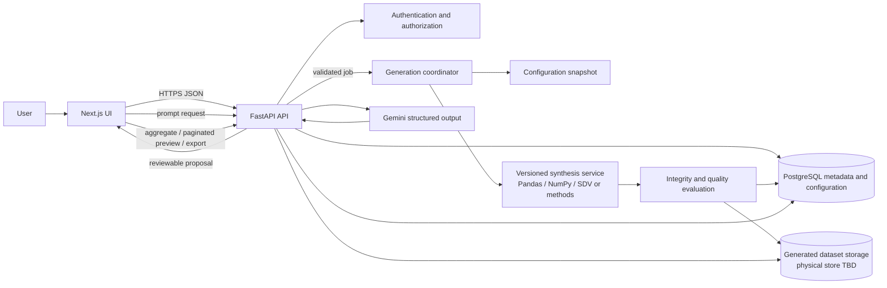

# BedSynth AI System Architecture

**Status:** Proposed architecture; not an implementation description. Components and deployment choices are subject to validation.

## System overview

BedSynth AI is planned as a web application backed by a Python API and a relational store. The browser manages configuration, run requests, previews, and analysis views. FastAPI validates requests and authorization, persists run metadata, and coordinates generation and evaluation. Generation is isolated behind a service boundary so statistical methods, constraints, and versioning can evolve without coupling them to UI or API route code. PostgreSQL stores account/workspace and operational configuration metadata; generated output storage is an open decision (initial bounded datasets may be relational, while larger outputs may require object storage).

Planned stack: Next.js, React, TypeScript, Tailwind CSS, shadcn/ui; Python/FastAPI/Pydantic; PostgreSQL/SQLAlchemy/Alembic; Pandas/NumPy; SDV and suitable statistical/generative methods; Gemini API structured outputs; Recharts; Vercel plus Render or Railway. No component is described as already deployed.

## Frontend and backend

### Frontend

- Next.js application provides responsive configuration, assistant review, generation status, analytics, previews, history, and export flows.
- TypeScript types should derive from or be checked against documented API schemas to reduce contract drift.
- UI components follow the design system in [DESIGN_SYSTEM.md](../design/DESIGN_SYSTEM.md), including accessible loading, error, empty, and success states.
- Large tables should use server-side pagination/filtering; chart payloads should be aggregates rather than full row collections.
- Client-side state should contain only the data needed for the active view; authoritative generation and access state remains server-side.

### API and services

- FastAPI exposes versioned JSON endpoints for identity/workspaces, hospital configuration, generation jobs, dataset metadata, quality results, summaries, previews, and exports.
- Pydantic schemas validate inbound and outbound contracts. SQLAlchemy models and Alembic migrations manage persisted relational structures.
- Route handlers should orchestrate domain services rather than contain synthesis algorithms.
- A generation coordinator records job state and invokes configuration validation, generation, integrity validation, quality evaluation, and output persistence.
- Background execution is expected for jobs beyond a short synchronous request; the specific queue/worker mechanism is intentionally undecided until workload and hosting are validated. Do not add a broker by default before that decision.

## AI and synthetic generation architecture

Generation and prompt interpretation are distinct workflows:

1. **Prompt interpretation:** The API sends a bounded prompt and approved context to Gemini using a structured output schema. Returned fields are parsed by Pydantic, checked against the user's hospital and allowed generation options, then shown for review. Invalid or unsupported values are rejected or returned for correction; the model cannot invoke generation directly or author executable code.
2. **Synthesis:** A versioned generation service consumes a validated configuration snapshot, seed, schema version, and selected method. It produces linked records and metadata using deterministic rules and/or selected SDV/statistical models. Cross-table constraints and temporal/capacity rules are validated after generation.
3. **Evaluation:** A separately versioned evaluator runs schema, relationship, temporal, configured-constraint, and descriptive checks. Results include method/version and findings. Statistical resemblance and privacy properties are not assumed from successful generation.

Every run should store enough provenance to identify effective inputs and code/model versions. Random-seed determinism is method-dependent and must be documented; external model calls may not be exactly reproducible.

## Database and output storage

PostgreSQL is proposed for users/workspaces, hospital configuration, generation requests, job status, dataset manifests, and evaluation summaries. Relational constraints should enforce ownership and core references. Data model details are in [DATABASE_SCHEMA.md](DATABASE_SCHEMA.md).

The storage location and physical representation of generated row data is unresolved. Options include relational tables for bounded initial volumes and object storage for larger immutable files. Before choosing, validate expected size, preview/query needs, retention/deletion requirements, tenant isolation, backup, and hosting capabilities. Do not treat metadata tables as a substitute for a storage design.

## API communication

- Browser-to-API communication uses HTTPS and versioned JSON endpoints.
- Request validation errors return a stable error shape with field-level details; authorization failures do not reveal another tenant's resource existence.
- Long-running generation is represented as a job resource: submit request, poll status (or later use a push channel if justified), read results on completion, and download authorized exports.
- Endpoints should support idempotency or duplicate-request protection for job submission where feasible.
- Pagination, filters, limits, and time ranges are explicit on preview and aggregate APIs.
- API schemas document units, time zones, nullability, and enum values. UTC storage is recommended; display timezone behavior needs product definition.

## Data flow

## Security considerations

- Require authentication and enforce tenant/resource ownership in service-layer queries as well as route dependencies.
- Use secure session/token handling, CSRF protections where cookie-based authentication is used, rate limiting for expensive operations, and input/size limits.
- Store secrets in deployment secret management; never expose Gemini credentials to the browser or commit secrets.
- Send only prompt context needed for interpretation to Gemini. Review provider retention, region, contractual terms, and user disclosure before launch. Avoid sending generated rows unless a future feature has explicit justification and review.
- Treat prompts, exports, and generated data as potentially sensitive user content; restrict logs and apply defined retention/deletion and backup policies.
- Validate uploaded/imported data if introduced later; uploads are out of MVP scope unless separately approved.
- Use parameterized database access, safe export encoding, dependency updates, and security review of file download paths.
- Establish incident response, audit needs, and account deletion behavior before production.
- Synthetic does not mean privacy-safe by definition; document threat model and evaluate memorization/disclosure risks for any fitted generator.

## Scalability and reliability considerations

- Separate API request latency from generation duration using persisted jobs and a worker model once measured workload warrants it.
- Make generation idempotent or safely retryable; persist job state transitions and failure reasons.
- Bound generation inputs and memory use. Pandas-based approaches may require chunking or a different execution strategy for large outputs; scale assumptions need measurement.
- Index tenant-scoped configuration/run lookups and time fields used in previews; avoid indexing every generated column without query evidence.
- Store immutable run outputs or manifests with explicit schema versions to preserve reproducibility.
- Add pagination, aggregate endpoints, and export streaming for larger datasets.
- Establish backup/restore, retention, observability, and availability objectives before public launch; numeric SLOs are intentionally unspecified pending workload and hosting validation.

## Deployment outline

The proposed frontend can deploy to Vercel and API/worker plus PostgreSQL to Render or Railway. This is a direction, not a selected vendor topology. Validate background worker support, persistent storage, database backups, private networking, secrets, regions, costs, and operational ownership before selecting a provider.
